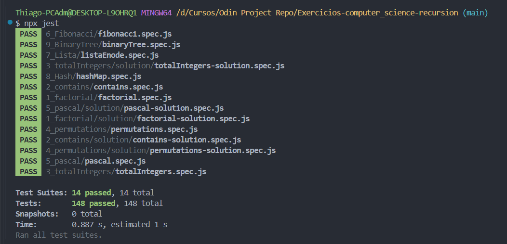
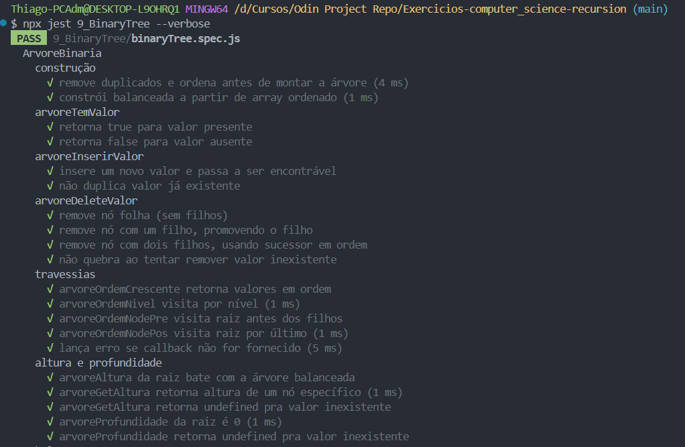

# Exercícios de Ciência da Computação — The Odin Project

Coleção de exercícios de recursão e estruturas de dados, parte do currículo Full Stack JavaScript do The Odin Project. Cada pasta contém a implementação e sua suíte de testes automatizados com Jest.




## 📂 Estrutura

| Pasta | Conceito | Arquivo principal | Testes |
|---|---|---|---|
| `1_factorial` | Recursão básica | `factorial.js` | ✅ |
| `2_contains` | Busca recursiva em estrutura aninhada | `contains.js` | ✅ |
| `3_totalIntegers` | Contagem recursiva com validação de tipos | `totalIntegers.js` | ✅ |
| `4_permutations` | Permutações via recursão | `permutations.js` | ✅ |
| `5_pascal` | Triângulo de Pascal | `pascal.js` | ✅ |
| `6_Fibonacci` | Fibonacci (iterativo e recursivo) + Merge Sort | `fibonacci.js` | ✅ |
| `7_Lista` | Lista encadeada (Linked List) implementada do zero | `listaEnode.js` | ✅ 18 testes |
| `8_Hash` | HashMap com redimensionamento automático | `hashMap.js` | ✅ 17 testes |
| `9_BinaryTree` | Árvore Binária de Busca balanceada | `binaryTree.js` | ✅ 23 testes |

## 🧪 Rodando os testes

```bash
npm install
npx jest              # roda todos os testes do projeto
npx jest 9_BinaryTree  # roda só uma pasta específica
npx jest --verbose    # mostra cada teste individualmente
```

Cada uma das pastas `7_Lista`, `8_Hash` e `9_BinaryTree` também tem um arquivo `mainTest.js` com exemplos de uso visual via `console.log` — para rodar manualmente:

```bash
node 7_Lista/mainTest.js
node 8_Hash/mainTest.js
node 9_BinaryTree/mainTest.js
```

## 🛠️ Tecnologias

`JavaScript (ES6+)` `Jest` `Node.js` `CommonJS`

## 📌 Destaques

- **Lista encadeada**: inserção/remoção por índice com tratamento de erro (`RangeError`)
- **HashMap**: redimensionamento automático ao ultrapassar fator de carga de 75%
- **Árvore Binária de Busca**: construção balanceada, as 4 travessias clássicas (nível, pré-ordem, pós-ordem, em ordem), cálculo de altura/profundidade e rebalanceamento